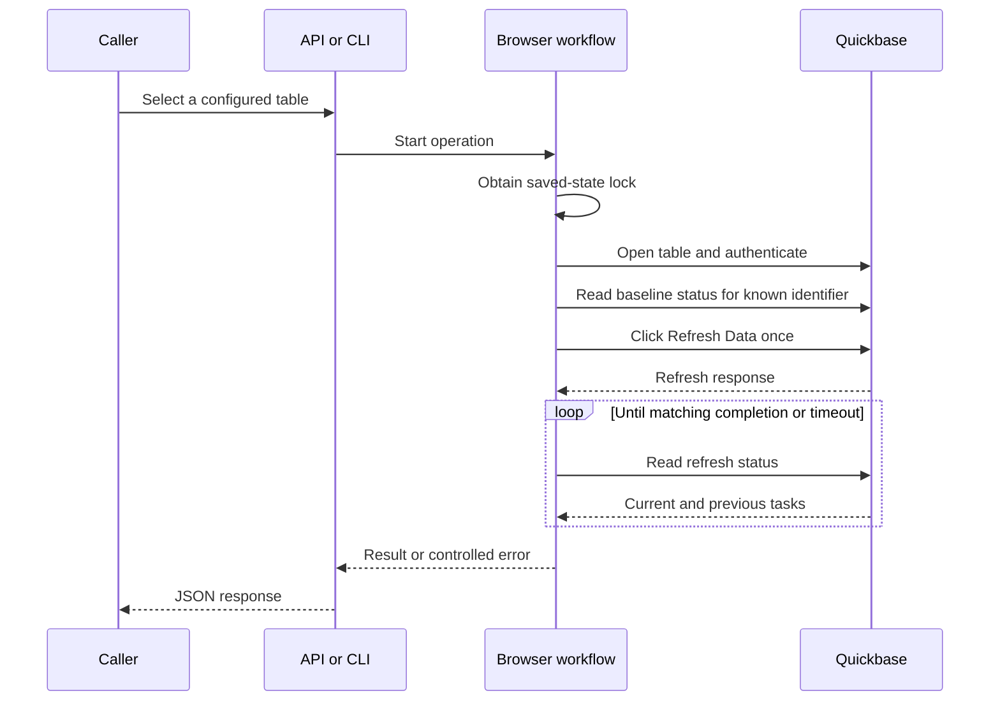

# Architecture

This project refreshes configured Quickbase connected tables through a headless browser.
It exposes the same workflow through a command-line interface and a small HTTP API.
The browser clicks **Refresh Data** once, then the program waits for a matching refresh task to finish.

## Components

| Component | Responsibility |
| --- | --- |
| `qb_refresh.py` | Loads configuration, manages the browser session, starts refreshes, tracks completion, and provides the CLI. |
| `api_server.py` | Loads startup configuration, authenticates callers, selects configured tables, and maps controlled errors to HTTP responses. |
| `RefreshSettings` | Validates configuration from a file and resolves the saved-state path relative to that file. |
| `RefreshTracker` | Separates a new refresh task from tasks and errors that existed before the click. |
| `tests/` | Covers configuration, task correlation, API behavior, and browser behavior against a local fake server. |

The API and CLI both call the asynchronous browser workflow.
Each operation launches a new browser and context, then closes the browser before it returns.
The saved browser state supplies session continuity between operations.

## Request flow

For API requests, bearer authentication precedes table selection and browser startup.
The route accepts only a configured table name.
The HTTP request remains open until the workflow returns a result or error.

The workflow finds controls in the configured realm and the Quickbase login origin, including frames.
It uses a configured refresh selector or several default selectors for **Refresh Data**.
The CLI `login` command stops after authentication and saves state.
The CLI `inspect` command also discovers the replication identifier and reads available baseline status, without a refresh click.

## Task correlation

The replication identifier identifies the connected table in refresh status requests.
The workflow uses a configured identifier, an observed request, or an identifier in the page markup.
If discovery exposes multiple identifiers, the workflow requires explicit configuration.

Before the click, the workflow reads baseline status whenever an identifier is available.
A current refresh produces `BUSY`, without a new click.
The baseline records identities from `currentRefresh`, `lastRefresh`, and `lastGoodRefresh`, plus the previous error.
Task identity uses `id`, then `taskId`, then `startTime`.

The workflow observes the response to the browser's refresh POST on the configured origin.
It then reads status through the browser context's request client, which shares the browser session.
`RefreshTracker` selects a task identity absent from the baseline.
Completion requires that identity in `lastRefresh` with numeric `status` equal to `3`.
An old success or unchanged previous error does not establish the new result.

Without a baseline, the first POST response must contain `currentRefresh`.
A previous success alone produces `START_UNCONFIRMED`, even after a fast refresh.
If a task timestamp includes a timezone, the workflow rejects a task that predates the click by more than ten seconds.
If the page does not expose an identifier before the click, explicit configuration still permits baseline correlation.

The result contains the table name, replication identifier, task identifier, UTC timestamps, and elapsed seconds.
The timestamps describe the local operation. They do not contain the upstream task's exact execution interval.
The elapsed time starts immediately before the click and excludes initial browser startup and authentication.

## One click and bounded waits

The workflow makes one refresh click attempt and does not repeat it after an uncertain result.
A missing response does not prove that Quickbase rejected the refresh.
An automatic second click can therefore start an additional refresh.

Separate configuration values control navigation, start confirmation, overall refresh completion, and the interval between status requests.
Until a new task appears, the start timeout limits the wait.
The refresh timeout starts after the click response. Task identification does not restart this timeout.
A timeout stops local observation and does not cancel an upstream refresh.

## Session state and concurrency

The workflow holds an operating-system file lock for the full browser operation.
The lock file uses the saved-state path plus `.lock`.
A competing local operation that uses the same path receives `BUSY` immediately.
This scope serializes all configured tables that share that state file.

The workflow saves cookies and browser storage, including IndexedDB, after authentication and after successful completion.
It writes a temporary file beside the state file, then replaces the state file atomically.
The state file contains authentication material and requires local protection.

The lock does not coordinate independent state paths, separate hosts, manual refreshes, or other clients.
There is no queue, durable job record, distributed lock, or API job-status endpoint.
The baseline and click also cannot exclude a competing upstream refresh between those two steps.

## Authentication and errors

The browser uses saved state or `QB_USERNAME` and `QB_PASSWORD` for supported login forms.
External sign-in flows require valid saved state.
The program does not automate interactive MFA or solve CAPTCHA challenges.

The API reads its bearer key at startup and compares supplied keys with `hmac.compare_digest`.
It disables generated documentation routes.
The public `/health` route reports process readiness, without a Quickbase connection test.

Expected failures use `RefreshError` with stable codes and controlled messages.
Upstream error text and Playwright details can contain secrets, so the workflow replaces them with controlled messages.
HTTP success alone does not establish refresh success: response content can still report a rejection.

## Dependencies and limits

The workflow depends on Quickbase page controls and the `/qb/sync/refreshTasks` response format.
Changes to selectors, authentication, task fields, or success status can require code changes.
Local tests exercise these assumptions against fixtures and a fake server.
They do not establish compatibility with a current Quickbase account or its sign-in policy.
